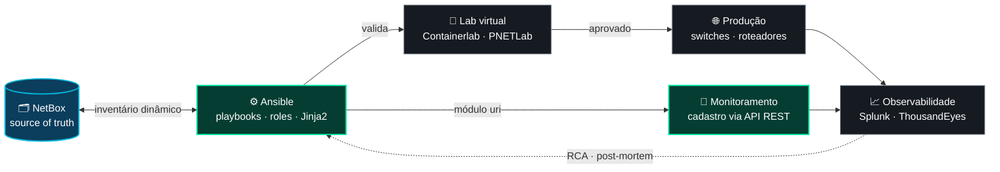

<!-- ============================== HEADER ============================== -->
<p align="center">
  
</p>

<p align="center">
  
</p>

<p align="center">
  <a href="https://www.linkedin.com/in/giovanny-lino" target="_blank"></a>
  <a href="mailto:giovannylino9@gmail.com"></a>
  <a href="https://giovannylino.vercel.app/" target="_blank"></a>
  
</p>

<p align="center">
  📍 Santo André, SP — Brasil &nbsp;•&nbsp; 🏢 Logicalis &nbsp;•&nbsp; 🎯 Rumo a <b>Engenheiro DevOps / SRE</b>
</p>

## 👨‍💻 Sobre mim

Analista de **Service Provider na Logicalis** e estudante de **Ciência da Computação (USCS)**. Atuo com **automação de infraestrutura, observabilidade e sustentação de ambientes críticos de operadoras de telecomunicações** — e uso desenvolvimento (Python, Node.js, TypeScript, SQL) para transformar trabalho manual em automação, integrações via API REST e ferramentas internas de operação.

```yaml
# $ kubectl get engineer giovanny-lino -o yaml
apiVersion: careers.dev/v1
kind: Engineer
metadata:
  name: giovanny-lino
  namespace: logicalis
  labels:
    role: service-provider-analyst
    track: devops-sre
    region: santo-andre-sp-br
spec:
  mission: "automatizar o repetitivo e tornar sistemas confiáveis e observáveis"
  focus: [infrastructure-as-code, observability, reliability, ci-cd]
  domain: [telecom, service-provider, network-automation]
  education:
    - Bacharelado em Ciência da Computação @ USCS   # 2024–2028, presencial
    - Técnico em Mecatrônica @ SENAI                # 2019–2021
  languages: { pt: nativo, en: avançado, es: intermediário, fr: básico }
  sideQuests: [minecraft]
status:
  phase: Running
  conditions:
    - type: Learning          # Kubernetes · Terraform · GitOps
      status: "True"
    - type: NextRelease       # Engenheiro DevOps / SRE
      status: "Progressing"
```

## 🛠️ Stack

<table>
  <tr>
    <td align="center" width="190"><b>⚙️ IaC & Automação</b></td>
    <td>
      <br/>
      
      
      
    </td>
  </tr>
  <tr>
    <td align="center"><b>📦 Containers & Orquestração</b></td>
    <td>
      <br/>
      
      
      
    </td>
  </tr>
  <tr>
    <td align="center"><b>☁️ Cloud</b></td>
    <td>
      <br/>
      
    </td>
  </tr>
  <tr>
    <td align="center"><b>🔄 CI/CD & GitOps</b></td>
    <td>
      
    </td>
  </tr>
  <tr>
    <td align="center"><b>📈 Observabilidade</b></td>
    <td>
      
      
      
      
      
    </td>
  </tr>
  <tr>
    <td align="center"><b>🌐 SO & Redes</b></td>
    <td>
      <br/>
      
      
      
    </td>
  </tr>
  <tr>
    <td align="center"><b>💻 Desenvolvimento</b></td>
    <td>
      
    </td>
  </tr>
  <tr>
    <td align="center"><b>🗄️ Dados</b></td>
    <td>
      <br/>
      
    </td>
  </tr>
  <tr>
    <td align="center"><b>🧭 Práticas</b></td>
    <td>
      <code>DevOps</code> <code>SRE</code> <code>Infrastructure as Code</code> <code>ITIL</code> <code>RCA & Post-mortem</code> <code>APIs REST</code> <code>Microsserviços</code> <code>Scrum</code> <code>Runbooks</code>
    </td>
  </tr>
</table>

## 🔁 Como eu automatizo uma rede

Pipeline que construí na Logicalis: o **NetBox** é a fonte da verdade, o **Ansible** aplica, o **lab** valida antes da produção e a **observabilidade** fecha o ciclo.



## 💼 Experiência

### 🟢 Analista de Service Provider · Logicalis
`Set/2026 → atual` · Santo André, SP

Sustentação e operação de ambientes de **operadoras de telecomunicações**, com responsabilidade sobre disponibilidade, desempenho e cumprimento de **SLA**.

- 📈 **Observabilidade fim a fim** com Splunk e ThousandEyes — dashboards, alertas, correlação de eventos e **análise de causa raiz (RCA)**
- 🤖 **Automação** operacional e de provisionamento com **Ansible + Python**, aplicando Infrastructure as Code e padronização de configurações
- 🚨 **Incidentes N2/N3** e gestão de problemas e mudanças (ITIL), com **post-mortems** e planos de ação
- 🔌 **Integrações via APIs REST** e rotinas de tratamento de dados operacionais em Python
- 🐳 Ferramentas internas de automação e coleta de dados empacotadas em **Docker / Podman**
- 📚 Documentação técnica, **runbooks** e procedimentos operacionais padronizados para o time

### ⚪ Estagiário de Engenharia de Telecomunicações · Logicalis
`Dez/2025 → Ago/2026`

- 🧩 Automação de rede com **Ansible** — playbooks, roles, inventário dinâmico e templates **Jinja2** para switches e roteadores
- 🔁 Pipeline **NetBox → Ansible** com sincronização bidirecional e provisionamento de monitoramento via API REST
- 🧪 Laboratórios virtualizados (**PNETLab** e **Containerlab**) para validar automações antes da produção
- ☁️ Migração de dashboard corporativo para **AWS Aurora PostgreSQL** com acesso seguro via **VPN WireGuard**, substituindo processos manuais em Excel
- 🩺 Correção do pipeline de ingestão Splunk → Power BI que descartava registros por falha no parsing de timestamps **ISO 8601**

## 🚀 Projetos em destaque

<table>
  <tr>
    <td width="50%" valign="top">

**📦 PoC-in-a-Box** &nbsp;<sub>🔒 interno</sub>

Plataforma que automatiza a criação de ambientes de *Proof of Concept*: topologias orquestradas no Containerlab, provisionamento com Ansible, jobs assíncronos com BullMQ e execução em Podman rootless.

`Containerlab` `Ansible` `Podman` `BullMQ` `Node.js` `Linux`

</td>
    <td width="50%" valign="top">

**🔁 NetBox + Ansible Pipeline** &nbsp;<sub>🔒 interno</sub>

NetBox como *source of truth*, inventário dinâmico no Ansible e cadastro automático dos dispositivos no monitoramento via API REST (módulo `uri`) — fim dos cadastros manuais.

`NetBox` `Ansible` `Jinja2` `YAML` `REST` `Python`

</td>
  </tr>
  <tr>
    <td width="50%" valign="top">

**☁️ Dashboard em AWS Aurora** &nbsp;<sub>🔒 interno</sub>

Base operacional migrada de planilhas para Aurora PostgreSQL, com conectividade via WireGuard, camada de acesso a dados, explorador de banco e deploy contínuo integrado ao GitHub.

`AWS Aurora` `PostgreSQL` `WireGuard` `Node.js` `React` `CI/CD`

</td>
    <td width="50%" valign="top">

**🛰️ [TelcoForge](https://github.com/GiovannyLino/TelcoForje)** &nbsp;<sub>🌐 [demo](https://telcoforge.vercel.app)</sub>

Cockpit de pré-vendas: gestão de conhecimento, agendamento de laboratórios e *discovery notes*. Regras de acesso no próprio banco com **RLS**, testes com Vitest + Playwright e deploy contínuo.

`React 19` `TypeScript` `Tailwind` `Supabase` `RLS` `Vercel`

</td>
  </tr>
  <tr>
    <td width="50%" valign="top">

**🧪 Lab de Automação de Redes**

Laboratório virtualizado para desenvolver e testar playbooks Ansible em switches e roteadores virtuais antes de qualquer mudança em produção.

`Ansible` `PNETLab` `Containerlab` `Linux` `IaC`

</td>
    <td width="50%" valign="top">

**🌐 [Portfólio](https://github.com/GiovannyLino/Portfolio)** &nbsp;<sub>🌐 [demo](https://giovannylino.vercel.app/)</sub>

Site pessoal com i18n (PT · EN · ES), tema claro/escuro e navegação por abas, publicado na Vercel.

`React` `TypeScript` `Vite` `Tailwind` `shadcn/ui`

</td>
  </tr>
</table>

## 🏅 Certificações

<p align="left">
  <br/>
  <br/>
  <br/>
  
</p>

## 📊 GitHub Stats

<p align="center">
  
  
</p>

<p align="center">
  <picture>
    <source media="(prefers-color-scheme: dark)" srcset="https://raw.githubusercontent.com/GiovannyLino/GiovannyLino/output/snake.svg" />
    <source media="(prefers-color-scheme: light)" srcset="https://raw.githubusercontent.com/GiovannyLino/GiovannyLino/output/snake-light.svg" />
    
  </picture>
</p>

<!-- ============================== FOOTER ============================== -->
<p align="center">
  
</p>
